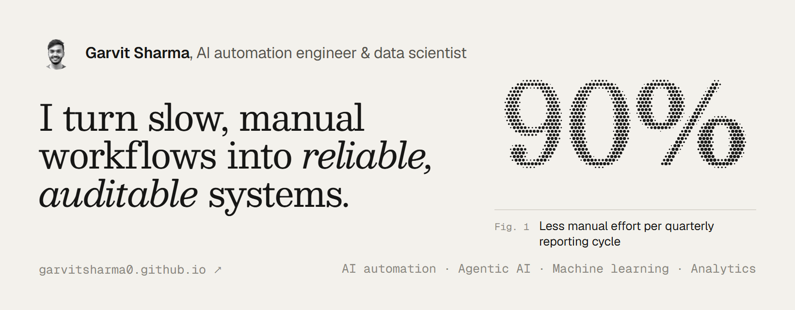

<a href="https://garvitsharma0.github.io/">
  <picture>
    <source media="(prefers-color-scheme: dark)" srcset="https://raw.githubusercontent.com/GarvitSharma0/GarvitSharma0/main/.github/assets/portfolio-card-dark.png">
    
  </picture>
</a>

